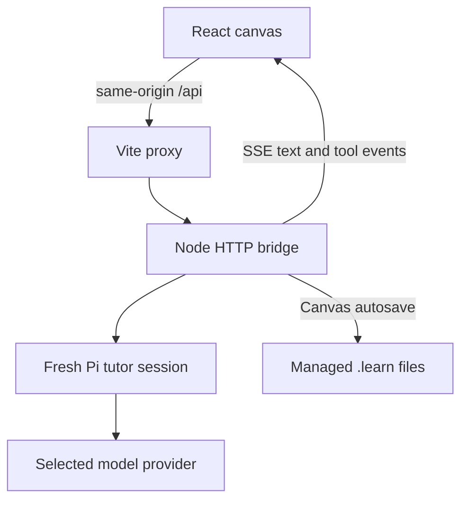

# Development

[← Learnvas](../README.md)

See [Getting started](getting-started.md) for installation and provider authentication.

## Commands

Run these from the project directory:

| Command | Purpose |
| --- | --- |
| `pnpm install` / `just setup` | Install dependencies. |
| `just learn` | Start the bridge and browser app together. |
| `pnpm bridge` | Start only the Pi bridge. |
| `pnpm dev` | Start only Vite. |
| `pnpm test` | Run Node's test runner for document serialization/validation/storage, isolated file-library APIs/security/recovery, global tutor-notes store security, thread switching/save failures/conflicts/stream ownership, portable import/export/cancellation/size bounds/cross-library round trips, deletion history, extension inventory, ports, and themes. |
| `pnpm build` / `just build` | Type-check TypeScript and build the frontend into `dist/`. |
| `pnpm preview` | Preview the built frontend; this is not a complete application launcher and does not start the bridge. |

## Architecture



- **Frontend:** React 19, TypeScript, Vite, and [React Flow](https://reactflow.dev/). Prompt and response cards are custom node types. `react-markdown`, `remark-gfm`, and `remark-breaks` render answer text.
- **Bridge:** Node's built-in HTTP server and `@earendil-works/pi-coding-agent`; no separate backend framework or database.
- **Conversation graph:** Directed edges connect cards. Before sending, `conversation.ts` resolves the prompt's context. Ordinary chains retain user/assistant messages; merge graphs use labeled reference cards with shared ancestors deduplicated and selected-only boundaries respected in later continuations. The bridge folds those messages into a transcript plus the new question for a fresh Pi session.
- **Streaming:** The bridge emits Server-Sent Events over the chat POST response. The frontend batches text updates with `requestAnimationFrame`.

Provider warmup, per-request extension loading, and tutor isolation are explained in [Models and configuration](configuration.md) and [Data and privacy](privacy.md).

## Source map

Paths below are relative to the project root.

| Path | Responsibility |
| --- | --- |
| `src/App.tsx` | Canvas state, persistence, model selection, branch history, and response lifecycle. |
| `src/nodes/` | Prompt and response card interactions and rendering. |
| `src/components/ResponseMarkdown.tsx`, `src/components/DiagramViewer.tsx`, `src/components/diagrams.css` | Markdown/Mermaid source fallback, inert diagram images, and portal-based modal zoom/pan viewer. |
| `src/lib/mermaid.ts`, `src/lib/mermaid.test.mjs` | Pre-render resource/config restrictions, lazy serialized Mermaid rendering, image sizing, zoom math, and source round-trip tests. |
| `src/components/NodePorts.tsx` | Hover **+** buttons and connection handles. |
| `src/components/ExtensionsPanel.tsx` | Read-only extension inventory. |
| `src/components/HelpButton.tsx`, `public/help.html` | Modal help overlay and its self-contained HTML guide. |
| `src/lib/api.ts` | Model/inventory requests and SSE consumption. |
| `src/lib/threadApi.ts`, `src/lib/threadWorkspace.ts` | Typed library client, queued mutations, revision-aware switching/autosave, import copy confirmation, and export save/read verification. |
| `src/lib/portableDocument.ts`, `src/lib/portableDocument.test.mjs` | Bounded portable uploads/downloads and isolated cross-library/error/collision tests. |
| `src/components/ThreadPanel.tsx` | Accessible collapsible thread management and file controls. |
| `src/components/TutorNotesPanel.tsx` | Collapsed top-right notes overlay: global and per-thread tutor notes with accordions. |
| `src/lib/conversation.ts`, `src/lib/mergeDraft.ts` | Merge context traversal, selected-only boundaries, stable source order, and merge-draft placement. |
| `src/components/SelectableCard.tsx` | Inert card controls plus accessible click/keyboard selection overlays. |
| `src/lib/ports.ts` | Available sides, branch placement, and response direction. |
| `src/lib/learnDocument.ts`, `src/lib/canvasStorage.ts` | Canonical `.learn` v5-only schema (strict, no legacy migration), validation/serialization, UI projection, and browser storage. See [format specification](learn-format.md). |
| `src/lib/fixtures/*.learn` | Representative portable canvases used by round-trip tests. |
| `src/lib/theme.ts`, `src/lib/useTheme.ts`, `src/theme.css` | Theme preference, system appearance, and color tokens. |
| `server/index.mjs` | Pi session creation, provider warmup, and bridge startup (loopback-only). |
| `server/tutor.mjs`, `server/tutor.test.mjs`, `server/tutorSdk.test.mjs` | Injectable capability/chat handler, confirmed generation metadata, memory-only SDK settings, and mocked/real no-prompt SDK checks. |
| `src/lib/thinking.ts`, `src/lib/comparison.ts`, `src/components/ThinkingChoices.tsx` | Per-prompt effort validation/controls, shared submission snapshots, non-overlapping sibling spacing, and truthful labels. |
| `server/http.mjs` | Trusted-origin/Host boundary, bounded JSON bodies, library routes, and structured errors. |
| `server/library.mjs`, `server/library.test.mjs` | Revision-checked durable `.learn` operations, collision confirmation, trash/restore, recovery journals, and isolated API/failure tests. |
| `server/tutorNotes.mjs`, `server/tutorNotes.test.mjs` | Bounded global tutor-notes store (`~/.learnvas/tutor-notes.json`), atomic saves, symlink refusal, and isolated tests. |
| `server/extensions.mjs` | Plain-JSON projection of loader metadata, without exposing runtime objects. |
| `vite.config.ts` | Frontend server and local API proxy. |

The bridge exposes `GET /api/models`, `GET /api/extensions`, `GET/PUT /api/tutor-notes`, `POST /api/chat`, and the [thread-library endpoints](thread-library.md#http-endpoints). Chat streams contain `metadata`, `delta`, `tool`, `done`, and `error` events. Initial `metadata` reports the resolved SDK session model and confirmed effort (or `unsupported`); omitted effort means unknown. It is emitted before text. EOF without a terminal event is an error, not success. Chat requests accept `model`, optional `thinking`, `messages`, `tutorNotes`, and optional `globalNotes`. New clients pin a concrete model and snapshot both note layers once per submission; sibling requests differ only in effort. Legacy single-chat callers that omit `globalNotes` still read the store. Notes use the SDK's native append mechanism; an empty snapshot explicitly suppresses APPEND_SYSTEM discovery. All routes enforce trusted local request headers. Library operations do not require model credentials or wait for Pi warmup.

`GET /api/models` returns `{ models, defaultModel }`. Each model includes SDK-derived `thinkingLevels`, `defaultThinking`, and `reasoning`; the default is resolved through a disposable no-generation session. No model identifiers, effort lists, or provider mappings are guessed. An old bridge contract disables submission with restart guidance.

Each chat uses a fresh in-memory SDK settings copy with automatic agent/provider retries, compaction, and cache warming disabled. Shared Pi settings are never changed. Web-enabled answers can still perform their ordinary tool/model turns; request counts describe response generations, not exact billing. Each answer has its own HTTP stream, AbortController, metadata, and stream owner; no background-session or server batch coordinator is introduced.

The bridge imports the canonical TypeScript validator using Node's built-in type stripping (Node 22.19+); no separate schema copy, database, or backend dependency is introduced. API tests use temporary directories and ephemeral loopback ports, never `~/.learnvas/`. The browser uses `threadApi.ts` and the serial mutation controller `threadWorkspace.ts`. `ThreadPanel.tsx` provides the collapsible sidebar; `streamOwner.ts` invalidates late generation callbacks when stopped/unmounted. Canvas bindings capture synchronous refs, including flushed stream buffers, before switching. A keyed provider remount resets graph and deletion history; saved viewports are applied on initialization. Legacy `canvasStorage.ts` remains only as a tested adapter, not active persistence.

## Contribution checks

Before submitting a change:

```bash
pnpm test
pnpm build
```

There is no committed browser-test runner yet. For UI changes, also manually check text-selection branching, all four continuation sides and the corner fallback, header dragging, resized-card collapse, and both color themes. Also verify S/click/M selection, both context scopes, unrelated roots, continuations, autosave/reload, shared-source deletion/undo, and Escape in zen mode. Describe the UI behavior you verified; see [merge verification](verification-merges.md), [Mermaid verification](verification-mermaid.md), and [thinking-effort verification](verification-thinking.md).

For bug reports, see [Troubleshooting](troubleshooting.md#reporting-a-problem).
