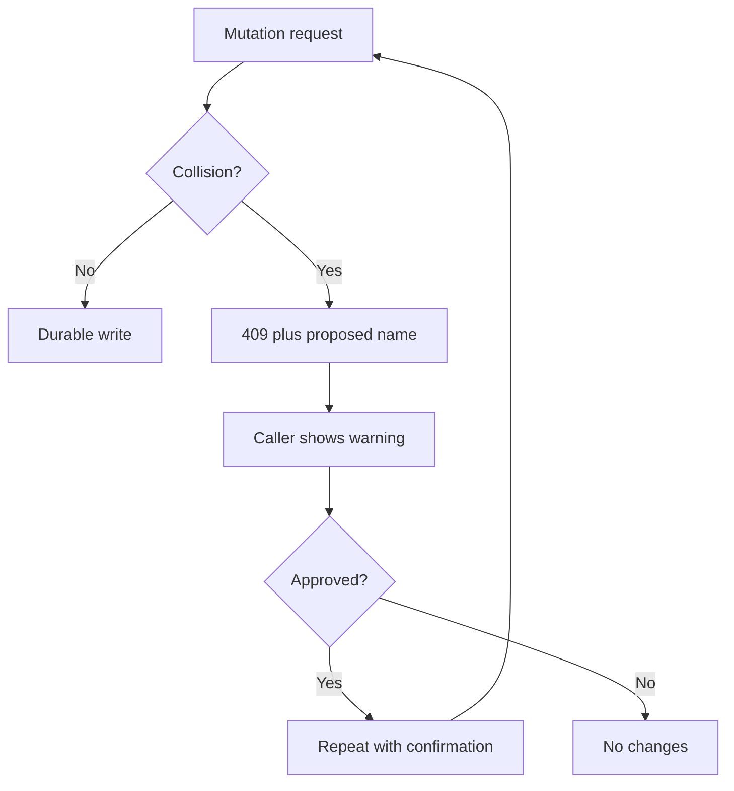

# Local thread library API

[← Learnvas](../README.md)

The bridge manages one self-contained [v1 `.learn` document](learn-format.md) per canvas under **`~/.learnvas/`**. It creates the directory and its **`.trash/`** subdirectory as needed, with private directory/file permissions for newly created entries.

The browser's **Threads** button opens a collapsible, keyboard-accessible sidebar. Create a named thread, select a saved thread, rename the active thread, move it to Trash, or view Trash and restore it. Every thread owns a complete canvas. Autosave uses these APIs, not browser canvas storage; the browser remembers only the last active ID and theme. Other profiles can reopen the same library.

Switching stops generation, flushes partial text, and saves the outgoing thread before replacing its canvas. Errors/conflicts keep the canvas available; **Retry save** retains the existing revision, while **Save recovery copy** with a new title creates a separate identity without overwriting the original. Never resolve a conflict by blindly refreshing its revision. Undo history resets on switch. Tab/Enter navigate thread buttons; the active button has `aria-current`. Esc closes the panel and returns focus. The panel fits narrow screens and is hidden in zen mode.

Existing `learnvas:document` and older `learnvas:v1` browser canvases are ignored, not automatically migrated or deleted. This rollout intentionally does not carry test canvases into the library. Automatic legacy migration and import/export UI remain separate work.

## HTTP endpoints

All bodies are UTF-8 JSON objects, with `Content-Type: application/json`. Unknown request fields are rejected. IDs in URLs must be URL-encoded; they are opaque lookup keys, **never paths**. There are no path/query parameters for selecting a directory or file. Read the revision before every mutation of an existing thread.

| Method | Endpoint | Body / result |
| --- | --- | --- |
| GET | `/api/threads` | Active thread summaries and warnings. |
| POST | `/api/threads` | `{ document, confirmFilename? }`; create a complete validated v1 document. Returns 201. |
| GET | `/api/threads/:id` | Read a complete active document. |
| PUT | `/api/threads/:id` | `{ document, revision }`; save without changing identity, creation timestamp, or title. |
| POST | `/api/threads/:id/rename` | `{ title, revision, confirmFilename? }`; update title and filename together. |
| POST | `/api/threads/:id/trash` | `{ revision, confirmFilename? }`; move to managed trash. |
| GET | `/api/trash` | Trashed thread summaries and warnings; not included in the active list. |
| GET | `/api/trash/:id` | Read a complete trashed document. |
| POST | `/api/trash/:id/restore` | `{ revision, confirmFilename? }`; restore without changing identity or document content. |

Read/create/save/rename/trash/restore return:

```json
{
  "document": { "format": "learnvas", "version": 1 },
  "filename": "Physics.learn",
  "revision": "<opaque revision token>"
}
```

The document above is abbreviated; requests must supply the full canonical document. New clients can use `createThreadMetadata` to generate a fresh UUID and timestamps. Titles and filenames never determine identity. Creating a document with an ID already present in active storage or trash fails; restores also reject active-ID conflicts rather than changing IDs or overwriting files.

List responses are `{ threads, warnings }`. Each summary has `threadId`, `title`, `createdAt`, `updatedAt`, `filename`, and `revision`. Corrupt, unsupported, oversized, symlinked, hardlinked, or non-regular `.learn` entries are preserved and reported as warnings. Valid neighboring documents remain usable. Duplicate IDs within a collection make **both** copies unavailable until the duplicate is resolved; neither is overwritten. Non-`.learn` entries are not documents and are ignored.

## Filename collisions need confirmation

Filenames preserve readable Unicode titles while replacing filesystem separators/reserved characters, avoiding special/reserved names, and bounding filename bytes. Titles are nonempty, at most 200 characters, without control characters. Managed IDs are at most 256 characters and cannot contain separators, control characters, or traversal components. These are library restrictions in addition to v1 schema validation.

Collisions are checked case-insensitively, including invalid files and directories. The bridge proposes a numbered name but **does not write until it is confirmed**:

```json
{
  "error": "Physics.learn already exists; confirm Physics (2).learn before saving",
  "code": "filename-conflict",
  "proposedFilename": "Physics (2).learn",
  "confirmationRequired": true
}
```

That response is HTTP 409. After displaying the warning and getting approval, repeat the request with `confirmFilename: "Physics (2).learn"`. If another writer occupies that name in the meantime, a new proposal requires new confirmation. This field can only confirm the bridge's current proposal; it cannot choose arbitrary paths or filenames. Duplicate displayed titles are allowed. Rename, trash, and restore follow the same rule.



## Revisions, durability, and recovery

Revisions combine the file's exact bytes and filesystem identity/change metadata. They are not timestamps or semantic content hashes. Even replacing a file with an identical copy invalidates an old revision. Bridge operations are serialized, with an exclusive writer lock protecting the same library from concurrent bridge processes. A stale revision returns HTTP 409 `revision-conflict`; a missing/invalid revision returns HTTP 428 `revision-required`. Re-read and resolve differences rather than blindly retrying with a new token.

Saves reject changed `threadId`, `createdAt`, and `title`; use rename for title changes. `updatedAt` cannot move backwards. Rename advances `updatedAt`; trash and restore preserve the entire document, including timestamps and partial response text. Loading never creates a Pi session or resumes generation.

Writes use private, exclusive staging files, file `fsync`, atomic publication/replacement, and directory `fsync`. New destinations use a no-clobber publication so a raced-in file cannot be overwritten. Title/filename changes and trash/restore use a durable `.transaction.json` journal: the destination is committed before the source is removed. On the next operation, including after restart, an interrupted transaction finishes idempotently. Unexpected changes to journaled copies stop recovery with an explicit conflict and preserve both copies. Never delete copies to resolve a conflict without backing them up and inspecting them first.

A filesystem error can occur **after a mutation became visible**. An error response is not a promise that nothing changed: re-read/list before retrying. No success response is sent before the required file/directory syncs finish. Filesystems must support these operations; failures are errors, not silently downgraded durability.

Revisions detect external changes up to the final comparison before atomic replacement. Node's filesystem API cannot atomically compare-and-swap against an unrelated editor writing in that final comparison/replacement window. **Stop the bridge before manually editing managed files**; the writer lock coordinates bridge instances, not arbitrary editors. The library must be on a local filesystem on the same machine, not a shared/network mount. Directory trees are assumed to be controlled by the trusted OS user, not concurrently replaced by a hostile local process.

Normal shutdown releases the writer lock. A lock left by a dead process is recovered on the next operation. If a crash leaves an incomplete `.writer-lock` or `.lock-recovery`, stop **all** bridge instances, back up the library, and remove only those stale lock files. Do not remove `.transaction.json` or its `.pending-*` document without inspecting/backing up the affected files; these can be needed for recovery. Orphan staging files are not exposed as threads or automatically purged.

## Size limits and errors

Documents, including canonical serialization, are limited to **8 MiB**. Request envelopes are bounded to 8 MiB + 64 KiB, including chunked requests. Compressed request bodies are rejected. Request/header timeouts and header counts are bounded. Invalid UTF-8, unknown schema fields, unsupported versions, invalid graphs, traversal, and unsafe files are rejected without rewriting their source.

Errors return `{ error, code, ...details }`. Common codes:

- 400: `invalid-request`, `invalid-json`, `invalid-id`, `invalid-title`, `invalid-filename`.
- 403: `untrusted-request`, `permission-denied`.
- 404: `not-found` (no valid managed thread has that ID).
- 409: `filename-conflict`, `id-conflict`, `revision-conflict`, `library-busy`, `recovery-conflict`.
- 413: `request-too-large`, `document-too-large`.
- 415: unsupported content type or compression.
- 422: schema/format/version validation, `immutable-metadata`, `unsafe-path`.
- 428: `revision-required`.
- 500: `io-error` (check storage, re-read before retrying).

## Local access boundary

The bridge binds **127.0.0.1 only**. Vite also defaults to a loopback bind and fixed port 5173. Every bridge route, including models/chat/inventory, checks the loopback peer, trusted Host, and browser Origin. Same-origin GET/HEAD requests without Origin need a same-host trusted Referer. Mutations require an explicit trusted Origin. Cross-site browser requests are rejected; no CORS access is granted.

By default, trusted origins are HTTP `localhost`, `127.0.0.1`, and `[::1]` on the bridge port and 5173. `LEARNVAS_TRUSTED_ORIGINS` can add comma-separated, exact HTTP(S) **loopback** origins for other local app ports. It cannot enable remote hosts. Vite forwards the original Host/Origin/Referer; do not set `changeOrigin: true` or put an untrusted remote proxy in front of the bridge.

For command-line clients, supply a trusted Origin explicitly:

```bash
curl -H 'Origin: http://localhost:5173' http://127.0.0.1:5178/api/threads
```

This is browser/network isolation, **not authentication against local processes**: a local program can forge headers. Only trusted local apps should run on allowlisted origins. Pi extensions still execute with bridge permissions; use a trusted OS account and extensions. The browser may fail API requests if a privacy policy strips the required Origin/Referer.

## Configuration and tests

`LEARNVAS_LIBRARY_DIR` is a trusted startup-only override for development/tests; request bodies cannot override it. Default: `~/.learnvas/`.

`pnpm test` runs `server/library.test.mjs` against isolated temporary directories and ephemeral loopback servers, never the user's real library. Tests exercise CRUD, confirmation races, strict validation, revisions, malformed files, bounds, permissions, interrupted writes/recovery, symlink/hardlink boundaries, trash/restore, and origin/Host checks.

Out of scope: automatic browser-canvas migration, arbitrary external paths, a file watcher, cloud/database storage, permanent-trash purge, and Pi session persistence.
