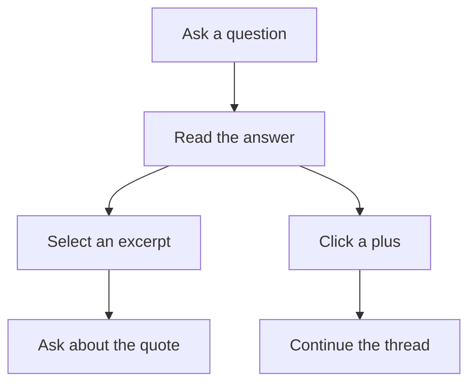

# Using the canvas

[← Learnvas](../README.md)

Open **Threads**, enter a title, and click **New thread**. Start with its empty prompt card, choose a provider and model in the toolbar, and ask something you want to understand.

The collapsible thread panel lists saved canvases and supports rename, recoverable trash, and restore. Tab to a thread and press Enter to switch; the current thread is labeled active. Esc closes the panel and returns focus. Switching stops streaming, saves partial answers as stopped, and resets deletion-undo history. Save failures/conflicts keep your current canvas open: use **Retry save**, or enter a new title and **Save recovery copy**. No newer revision is silently overwritten.

## Move an exploration between machines or profiles

In **Threads**, use **Save and export active** to save the latest canvas and download a human-readable `.learn` file. Active answers stop and preserve their partial text. Nothing downloads if saving fails or conflicts.

Use **Import .learn** in another library/browser profile, confirm its title, then select it in the saved-thread list. Import does not switch or change your current canvas. Duplicate IDs offer only a separately confirmed copy; filename collisions require approval of a numbered name. Cancel leaves the library unchanged. Files include text, drafts, quotes, branches, layout, sizes, and viewport—but not credentials, runtime activity, or undo. Text is not redacted. See [portable file controls](thread-library.md#portable-import-and-export).

## Explore a conversation

- **Branch from a passage.** Select text in an answer or prompt input and release the mouse to create a connected prompt with that excerpt quoted.
- **Continue without a quote.** Hover over a card and click **+** on an unused side. If all four sides have connections, a top-right **+** remains available.
- **Compare answers.** Change the selected model and re-run a prompt to add another response without replacing the previous one.

A selected passage or **+** creates a **draft**, not an immediate model request. Sending the draft uses the model selected at that moment and includes its ancestral conversation history. Other branches are not included unless you explicitly merge them.

## Merge conversations

1. Press **S** (outside an input), or click **Select cards (S)**, to enter selection mode.
2. Click any two or more prompt/response cards, including cards from unrelated roots. Click again to deselect. Card controls and dragging are paused while selecting; Tab/Space/Enter can also toggle the selection buttons.
3. Press **M**, or click **Merge (M)**. A connected merge draft opens and focuses its input. No model request starts yet; originals stay intact.
4. Choose **Selected cards only** or **Cards + histories** (default). The first sends only source-card content, while the second includes earlier discussion and shared history once. One setting applies to the whole merge; [per-source controls are deferred](https://github.com/rinaldo-rex/learnvas/issues/22).
5. Write instructions such as “Merge only the criticism about X and Y,” then send normally. A separate response appears using the selected model.

**Esc** or **S** cancels selection. **M** needs at least two cards. The selection bar stays available in zen mode. Selection is temporary, not saved; drafts, connections, and the context setting are saved. Once sent, a scope badge stays visible and the setting is locked; create a new merge to compare scopes. Continue from the response normally: excluded histories do not silently return in later replies, including nested history merges.

Deleting one source disconnects it but preserves a shared merge while another source remains. Deleting the merge itself, or all of its sources, removes its downstream branch. Undo restores source cards and connections. Context is assembled from the current source text at send/re-run time, not a frozen snapshot.

## Tune the tutor with notes

Open the **Notes** chip in the top-right for standing requests the tutor follows on every new question — for example “use mermaid diagrams for structure” or “keep answers under 300 words”.

- **Global · all threads** applies everywhere and is stored once per machine in `~/.learnvas/tutor-notes.json`.
- **This thread** applies only here, is saved inside the thread's `.learn` file, and travels with export/import.

Edits shape answers from the next question onward; they do not rewrite answers already on the canvas. Both sections cap at 4000 characters. Notes are plain instructions for the tutor — avoid pasting secrets into them (see [privacy](privacy.md)).

For example, ask “How do neural networks learn?”, select “gradient descent” in the answer, and write “Can you elaborate more on this?” in the new quoted prompt. The explanation becomes a new response on that branch.

## Controls and shortcuts

| Action | How it works |
| --- | --- |
| Send a prompt | Click **Ask →** or press **Ctrl+Enter** / **Cmd+Enter**. Plain Enter adds a newline. |
| Quote and branch | Select text in an answer or prompt input, then release the mouse. A connected draft opens with the quote and a focused input. Add your question and send it. |
| Continue without a quote | Hover over a card and click a **+**. A blank prompt appears on the chosen side, and the canvas brings it into view. |
| Start a separate conversation | Click **＋ New prompt** in the toolbar. This creates a new root rather than a continuation. |
| Select cards | Press **S**, then click cards to toggle their selection. Press **Esc** or **S** to cancel. |
| Merge selected cards | Select at least two cards, press **M**, choose context, write instructions, and send. |
| Compare models | Choose another model, expand a sent prompt, and click **↻ Re-run**. The original response stays on the canvas. |
| Move a card | Drag its header. Dragging answer text selects it rather than moving the card. |
| Collapse or expand | Click an answer's header or a sent prompt's header. Draft prompts stay expanded. |
| Resize an answer | Drag its bottom-right resize grip. Its size is restored after collapsing and expanding. |
| Inspect a Mermaid diagram | After an answer finishes, its Mermaid blocks render inline. Click **Open larger view**, scroll to zoom, drag to pan, or use **−**, **+**, and **Reset to fit**. **Esc** or **Close ×** returns to the card without changing the canvas. |
| Navigate | Drag empty canvas space to pan; use wheel/trackpad gestures, zoom controls, fit-view, or the minimap. Scrollable card content keeps wheel scrolling inside the card. |
| Stop an answer | Click **■ stop** while the response is streaming. The partial answer remains. |
| Delete a branch | Click **×** on a card, or hover over it and press **X**. That card and its unshared descendants are removed; shared merges survive while another source remains. |
| Undo deletion | Press **Ctrl+Z** / **Cmd+Z** outside inputs and modals to restore the last deleted branch. Only deletion is undoable; other canvas changes are kept. |
| Reset the canvas | Click **Clear** and confirm. This removes the current canvas, not your theme preference or Pi credentials. |
| Change appearance | Choose **Theme: System**, **Light**, or **Dark**. System mode reacts to OS appearance changes. |
| Open help | Press **?** (**Shift+/** on a US keyboard) or click **?** at the top-right. Close the overlay with **Esc**, **Close ×**, or a click outside it. |
| Toggle zen mode | Press **Z** to hide or restore the thread controls, toolbar, extensions panel, notes chip, help button, zoom controls, and minimap. Cards and their controls stay visible. |
| Tune the tutor | Click the **Notes** chip (top-right) for standing requests: **Global · all threads** applies everywhere; **This thread** applies here and travels on export/import. Applied to every new question. |
| Command palette | Press **Ctrl+K** / **Cmd+K**. The palette is empty for now; **Esc** closes it. |

The single-key shortcuts (**S**, **M**, **X**, **?**, **Z**) do not run while typing in an input or while a modal is open. Holding a key down does not repeat an action.

While editing, **Ctrl+Z** / **Cmd+Z** is left to the input's native text editing rather than canvas history. Canvas deletion history retains up to 50 deletions until a thread switch, reload, or **Clear**; there is no redo yet. Restored streaming answers are marked stopped, not restarted.

Answers stream as Markdown, including headings, links, code blocks, lists, and tables. With web access enabled, the tutor can look up current information and supply sources.

Fenced `mermaid` blocks render locally as static diagrams once generation finishes (including stopped answers with valid blocks). Saved and imported diagrams render without model credentials. Each diagram has its own larger viewer and **Diagram source** disclosure. During streaming, or if a diagram cannot render, its source remains readable; surrounding Markdown is unaffected.

This is a read-only diagram viewer, not a full Mermaid embed: configuration/frontmatter, embedded assets/HTML (apart from simple ` ` line breaks), links, custom style directives, and escaped source are conservatively kept as source rather than executed. Very large diagrams also fall back to source (30,000 characters / 300 edges). Original Markdown is preserved verbatim in `.learn` files; SVG images and viewer zoom/pan are not saved.

Cards, text/quotes/model identifiers, connections, explicit sizes/collapse state, and viewport autosave to the active file in `~/.learnvas/` using the [`.learn` document format](learn-format.md). The toolbar shows unsaved/saving/saved/error/conflict status. Browser test canvases are not migrated. Reloading restores the saved view and never resumes generation. See [Data and privacy](privacy.md) before treating that storage as a durable record.

Related: [Models and configuration](configuration.md) · [Troubleshooting](troubleshooting.md).
