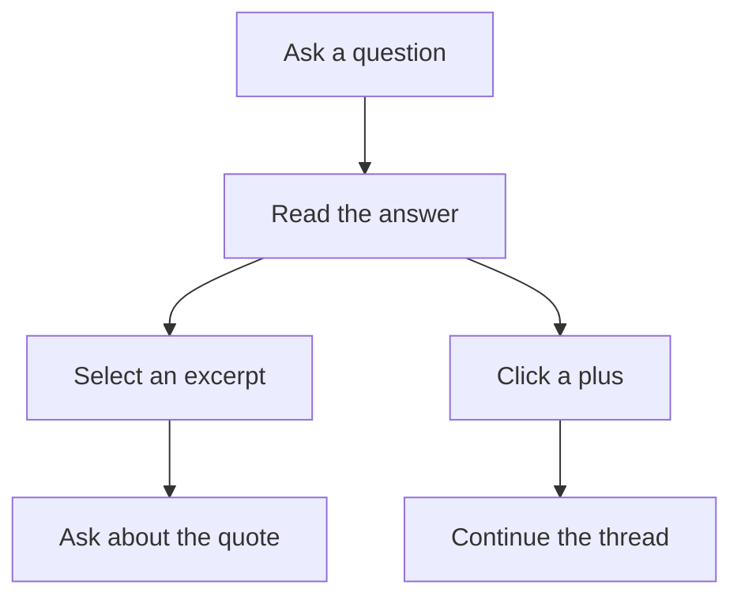

# Using the canvas

[← Learnvas](../README.md)

Start with the empty prompt card, choose a provider and model in the toolbar, and ask something you want to understand.

## Explore a conversation

- **Branch from a passage.** Select text in an answer or prompt input and release the mouse to create a connected prompt with that excerpt quoted.
- **Continue without a quote.** Hover over a card and click **+** on an unused side. If all four sides have connections, a top-right **+** remains available.
- **Compare answers.** Change the selected model and re-run a prompt to add another response without replacing the previous one.

A selected passage or **+** creates a **draft**, not an immediate model request. Sending the draft uses the model selected at that moment and includes its ancestral conversation history. Other branches are not included.

For example, ask “How do neural networks learn?”, select “gradient descent” in the answer, and write “Can you elaborate more on this?” in the new quoted prompt. The explanation becomes a new response on that branch.

## Controls and shortcuts

| Action | How it works |
| --- | --- |
| Send a prompt | Click **Ask →** or press **Ctrl+Enter** / **Cmd+Enter**. Plain Enter adds a newline. |
| Quote and branch | Select text in an answer or prompt input, then release the mouse. A connected draft opens with the quote and a focused input. Add your question and send it. |
| Continue without a quote | Hover over a card and click a **+**. A blank prompt appears on the chosen side, and the canvas brings it into view. |
| Start a separate conversation | Click **＋ New prompt** in the toolbar. This creates a new root rather than a continuation. |
| Compare models | Choose another model, expand a sent prompt, and click **↻ Re-run**. The original response stays on the canvas. |
| Move a card | Drag its header. Dragging answer text selects it rather than moving the card. |
| Collapse or expand | Click an answer's header or a sent prompt's header. Draft prompts stay expanded. |
| Resize an answer | Drag its bottom-right resize grip. Its size is restored after collapsing and expanding. |
| Navigate | Drag empty canvas space to pan; use wheel/trackpad gestures, zoom controls, fit-view, or the minimap. Scrollable card content keeps wheel scrolling inside the card. |
| Stop an answer | Click **■ stop** while the response is streaming. The partial answer remains. |
| Delete a branch | Click **×** on a card, or hover over it and press **X**. That card **and all downstream cards** are removed. |
| Undo deletion | Press **Ctrl+Z** / **Cmd+Z** outside inputs and modals to restore the last deleted branch. Only deletion is undoable; other canvas changes are kept. |
| Reset the canvas | Click **Clear** and confirm. This removes the current canvas, not your theme preference or Pi credentials. |
| Change appearance | Choose **Theme: System**, **Light**, or **Dark**. System mode reacts to OS appearance changes. |
| Open help | Press **?** (**Shift+/** on a US keyboard) or click **?** at the top-right. Close the overlay with **Esc**, **Close ×**, or a click outside it. |
| Toggle zen mode | Press **Z** to hide or restore the toolbar, extensions panel, help button, zoom controls, and minimap. Cards and their controls stay visible. |
| Command palette | Press **Ctrl+K** / **Cmd+K**. The palette is empty for now; **Esc** closes it. |

The single-key shortcuts (**X**, **?**, **Z**) do not run while typing in an input or while a modal is open. Holding a key down does not repeat an action.

While editing, **Ctrl+Z** / **Cmd+Z** is left to the input's native text editing rather than canvas history. Canvas deletion history retains up to 50 deletions until a reload or **Clear**; there is no redo yet. Restored streaming answers are marked stopped, not restarted.

Answers stream as Markdown, including headings, links, code blocks, lists, and tables. With web access enabled, the tutor can look up current information and supply sources.

Cards, text/quotes/model identifiers, connections, explicit sizes/collapse state, and viewport are saved in browser-local storage using the [`.learn` document format](learn-format.md). Reloading restores the saved view and never resumes generation. See [Data and privacy](privacy.md) before treating that storage as a durable record.

Related: [Models and configuration](configuration.md) · [Troubleshooting](troubleshooting.md).
