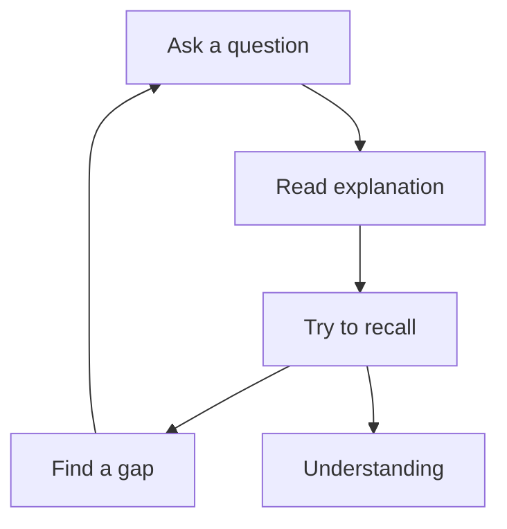
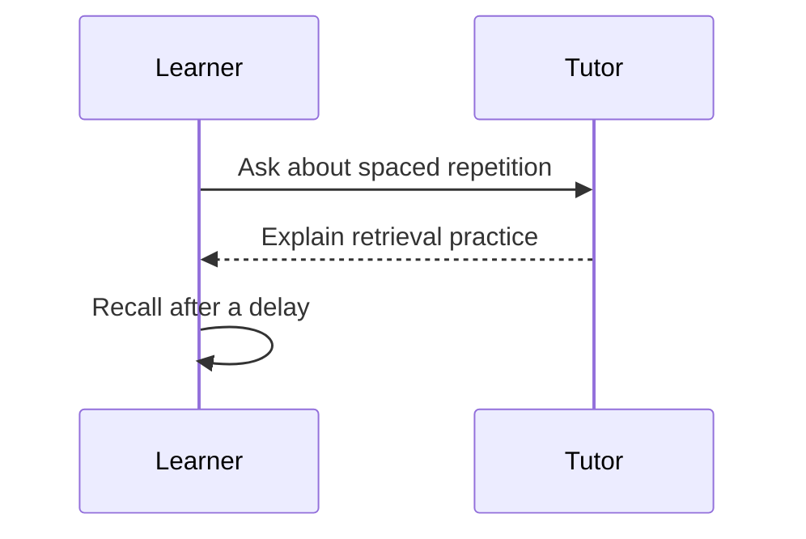
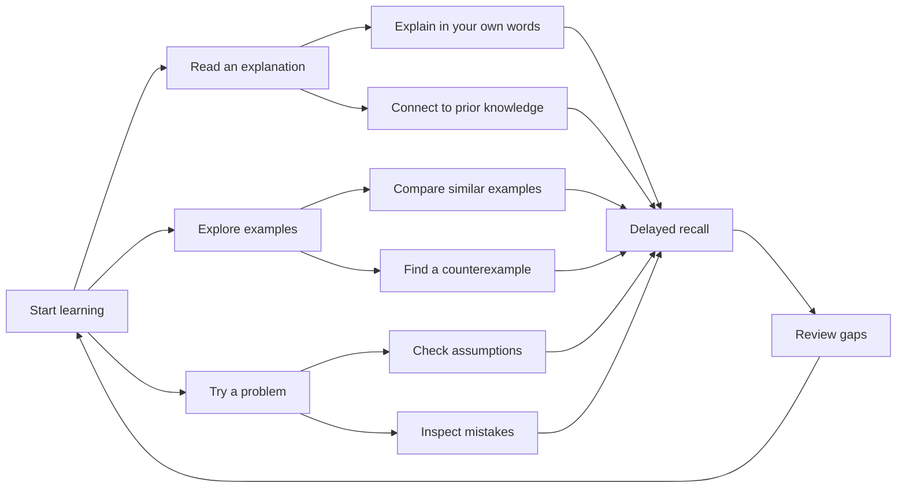
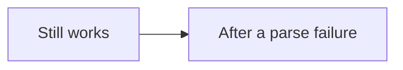

# Diagram reading fixture

Ordinary Markdown, **emphasis**, and `inline code` stay intact.

```js
console.log('not a diagram')
```



A second diagram has independent content and a separate larger view.



A dense diagram should be inspectable without enlarging the card.



A malformed block must not prevent later blocks from rendering.

```mermaid
flowchart TD
  A[Unclosed node
```


